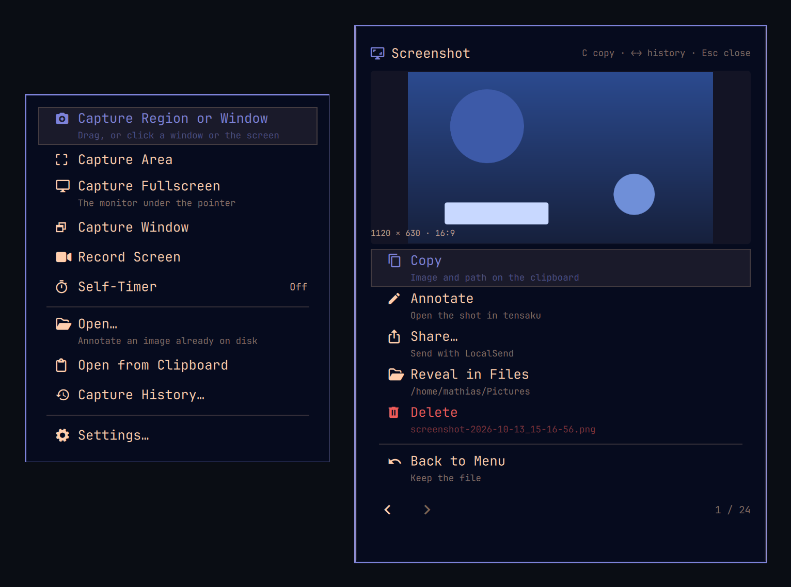

# Snapmenu — screenshots for [Omarchy](https://omarchy.org)

Click the camera in the bar, choose what to capture, and one key puts the shot on
your clipboard. No toolbar to learn, no window to find, nothing of the menu ever
in the picture.



## One shot, start to finish

1. **Click the camera in the bar** and the capture menu drops down. Middle-click
   jumps straight to history, and right-click skips the menu for an area. Or bind
   the menu to a key — see [Install](#install) — and press that instead.
2. **Choose what to capture**: drag an area, or just *click a window* and Snapmenu
   outlines exactly what it will take. The screen is frozen the moment the picker
   opens, so nothing moves or repaints under your drag.
3. The shot is saved to your Pictures folder and the card appears. Press **`C`** to
   put it on the clipboard, or pick **Annotate**, **Share…**, **Reveal in Files**
   or **Delete**.
4. **`Esc`** closes the card. The file stays where it is, and your clipboard is
   left exactly as you found it.

Nothing to confirm, nothing left open. Nothing goes on the clipboard unless you
press **Copy** — switch on **Copy file to clipboard** in Settings and every shot
lands there the moment it is taken instead. Turn off **Show action card** as well
and a capture is saved and forgotten.

## Why it feels quick

- **The screen freezes while you aim.** You are choosing from a still frame, not
  from a live desktop that scrolls and repaints beneath your selection.
- **The menu can't end up in your screenshot.** Snapmenu waits for its own
  surface to be gone before it looks at the screen.
- **You can see what you picked.** The selection is outlined and lightly washed;
  the dim over everything else is there if you want it, and both are adjustable.
- **It tells you the size and the shape**: `1600 × 900 · 16:9`,
  `1440 × 900 · 16:10 (MacBook)`, `1170 × 2532 · 19.5:9 (iPhone)`.
- **Your recent shots are one key away**: `H`, or a middle-click on the bar icon.
- **Paste the picture, or the path.** A chat window takes the image; a shell takes
  the path. The path needs the small native helper — see below.

## The menu

```
󰄀  Snapmenu                       Enter run · D timer · Esc close
 󰄁  Capture Region or Window      Drag, or click a window or the screen
 󰙟  Capture Area
 󰑖  Capture Previous Area
 󰥑  Capture Fullscreen           The monitor under the pointer
 󰖲  Capture Window
 󰏽  Record Screen
 󰔛  Self-Timer             Off
 ──────────────────────────────────────────────────────────────────
 󰝰  Open…                        Annotate an image already on disk
 󰁿  Open from Clipboard
 󰋚  Capture History…             3 recent shots
 ──────────────────────────────────────────────────────────────────
    Settings…
```

**Region or Window** is the one to learn: drag for an area, click for a window,
click empty space for the whole screen. Everything else is the version of that
which skips a step — **Area** to always drag, **Window** to always click,
**Fullscreen** for the monitor you are on, and **Previous Area** to shoot the
same rectangle you used last time without drawing it again.

**Self-Timer** counts down 0, 3, 5, 10 or 15 seconds before the shot, so you have
time to arrange what you are capturing; the bar icon shows a timer badge while it
is armed, and `Esc` cancels it.

**Record Screen** hands off to Omarchy's screen recording, and the bar icon shows
the same red dot Omarchy uses while it runs — whether the recording was started
here or anywhere else.

**Open from Clipboard** appears only when the clipboard holds an image — a copied
picture, or a shot from another one of these rows. A path or a paragraph on the
clipboard leaves nothing for it to open, so the row is not offered; **Previous
Area** does the same disappearing act until there is a region to repeat.

## Install

```bash
omarchy plugin add https://github.com/analytically/snapmenu --enable
```

`--enable` asks which bar section to put the icon in. Every shot goes on the
clipboard as an image. To have the file **path** on the clipboard as well — which
is what a shell prompt or a file field wants — build the small native helper:

```bash
make native          # Rust toolchain; without it you get the image alone
```

Afterwards:

```bash
omarchy plugin list                                                # confirm it is discovered
omarchy bar move io.github.analytically.snapmenu --section right   # if you change your mind
omarchy plugin disable io.github.analytically.snapmenu             # without removing it
```

There is no keybinding until you add one. This is the one Snapmenu is developed
with, and it is what the examples below assume:

```lua
-- ~/.config/hypr/bindings.lua
o.bind("SUPER + SHIFT + S", "omarchy-shell shell toggle io.github.analytically.snapmenu '{}'", "Snapmenu")
o.bind("SUPER + SHIFT + A", "omarchy-shell shell call io.github.analytically.snapmenu captureArea ''", "Capture area")
```

## While you are aiming

- **Drag** to pick an area, **click a window** to snap to the whole window,
  **click empty space** for the monitor.
- **`Tab`** cycles the windows under the keyboard, if you would rather not use
  the pointer; **`Enter`** takes the highlighted one.
- **Hold `Shift`** while dragging and the height stays put, so only the width
  moves; **`Shift + Ctrl`** does the same for the height. The legend tells you
  which constraint is active.
- **`Esc`** or a right-click cancels the pick and puts you back where you were.

## On the card

| Key | Does |
|---|---|
| `C` | copy the image and its path |
| `A` | annotate in tensaku |
| `S` | share with LocalSend |
| `R` | reveal the shot in Files |
| `X` | delete it (to the Trash, unless you say otherwise) |
| `←` `→` | step through recent shots without leaving the card |
| `Esc` | close the card — the shot is already saved |

Copying, annotating, sharing and revealing all hand the shot off and get out of
the way: the card closes as soon as one of them runs.

## Where your shots go

Your Pictures folder, named `screenshot-2026-10-13_14-41-02.png`, unless you
pick somewhere else in Settings.

**Capture History** is simply that folder — the newest shots, with how long ago
each was taken and how big it is. Deleting from there sends the file to the
Trash, so a mistake is recoverable from your file manager.

## Settings

Open **Settings…** in the menu, or edit this plugin's entry in
`~/.config/omarchy/shell.json`:

| Key | Default | Meaning |
|---|---|---|
| `copyToClipboard` | `false` | Copy every shot to the clipboard as it is taken, image and path |
| `saveToDisk` | `true` | Keep the shot in your Pictures folder; off writes a temporary file |
| `showResult` | `true` | Open the action card after a capture |
| `openAnnotate` | `false` | Hand every shot straight to tensaku |
| `exportDir` | `""` | Export folder; empty follows the Omarchy default |
| `showCursor` | `false` | Draw the pointer into the screenshot |
| `delay` | `0` | Self-timer: 0 (off), 3, 5, 10 or 15 seconds |
| `glaze` | `0.1` | Wash over the area being captured: 0, 0.06, 0.1, 0.14 or 0.2 |
| `dim` | `0` | Darkening outside the selection: 0 (off), 0.25, 0.4 or 0.55 |
| `cardWidth` | `500` | Width of the action card: 360, 500, 620 or 760 |
| `deleteMode` | `"trash"` | Where a deleted shot goes: `trash` or `permanently` |
| `confirmDelete` | `false` | Ask before deleting a shot |

The card's own width can also be dragged: grab either edge, and the preview grows
with it.

## The cursor

`grim` never draws the pointer, but Hyprland composites it when software cursors
are in use — so, like Omarchy's own capture, Snapmenu forces hardware cursors
during a shot and the pointer stays out of your screenshots. `showCursor` inverts
that when the shot is meant to point at something. In an area capture the pointer
appears where it was when the frame was frozen, not where the drag ended.

## Scripting it

Everything the menu does is one command away:

```bash
omarchy-shell snapmenu.menu toggle                                 # the bar dropdown
omarchy-shell shell call io.github.analytically.snapmenu captureArea ''
omarchy-shell shell call io.github.analytically.snapmenu capturePrevious ''
omarchy-shell shell call io.github.analytically.snapmenu captureAreaAt '1600,900 300x200'
omarchy-shell shell call io.github.analytically.snapmenu openHistory ''
```

`debugState` reports what the plugin is doing right now, which is the first thing
to ask for when something looks wrong. [DEVELOPING.md](DEVELOPING.md) lists every
entry point and the payloads the dropdown uses.

## When agent paste doesn't work

Two things decide whether pasting an image into Claude Code, Codex and friends
works at all, and both are worth checking before blaming either end:

- On Wayland the agents read the clipboard through `wl-paste`, and they prefer
  `xclip` if it is installed — which silently pastes **text instead of the
  image**. If image paste fails, check for `xclip`.
- A terminal that intercepts `Ctrl+V` never lets the agent see the keypress.
  Ghostty's `performable:` paste prefix exists for exactly that. And no terminal
  can deliver image bytes to a TUI at all — no clipboard-image protocol is widely
  implemented — which is why the agents reading `wl-paste` directly is the path
  that works.

## Not there yet

- **Pin a shot to the screen** — a pinned, always-on-top screenshot wants its own
  layer window; planned.
- **Scrolling capture** — needs frame stitching; not implemented.
- **Cloud upload** — out of scope; `omarchy share file` does that.
- **Text extraction (OCR)** — the menu row was removed for now; `omarchy capture
  text` still does it from the command line.
- **A toolbar inside the picker** — record and pin are menu rows today rather
  than buttons on the selection overlay.

## Uninstall

```bash
omarchy plugin remove io.github.analytically.snapmenu     # or: omarchy plugin disable <id>
rm -rf "${XDG_STATE_HOME:-$HOME/.local/state}/snapmenu"  # freeze frames and clipboard snapshots
```

That leaves nothing behind. The plugin writes only inside its own folder in
`~/.config/omarchy/plugins/` and that state directory; the settings it adds to
`shell.json` go away with its `bar.layout` entry, and the shots it made are files
in your export folder that outlive uninstalling it.

## License

MIT — see [LICENSE](LICENSE). Snapmenu is also built to be listed on
[plugins.omarchy.org](https://plugins.omarchy.org); see
[PUBLISHING.md](PUBLISHING.md) for that procedure.

---

Working on the plugin itself? Requirements, architecture, the test suites and the
`SNAPMENU_*` test hooks are in [DEVELOPING.md](DEVELOPING.md).
